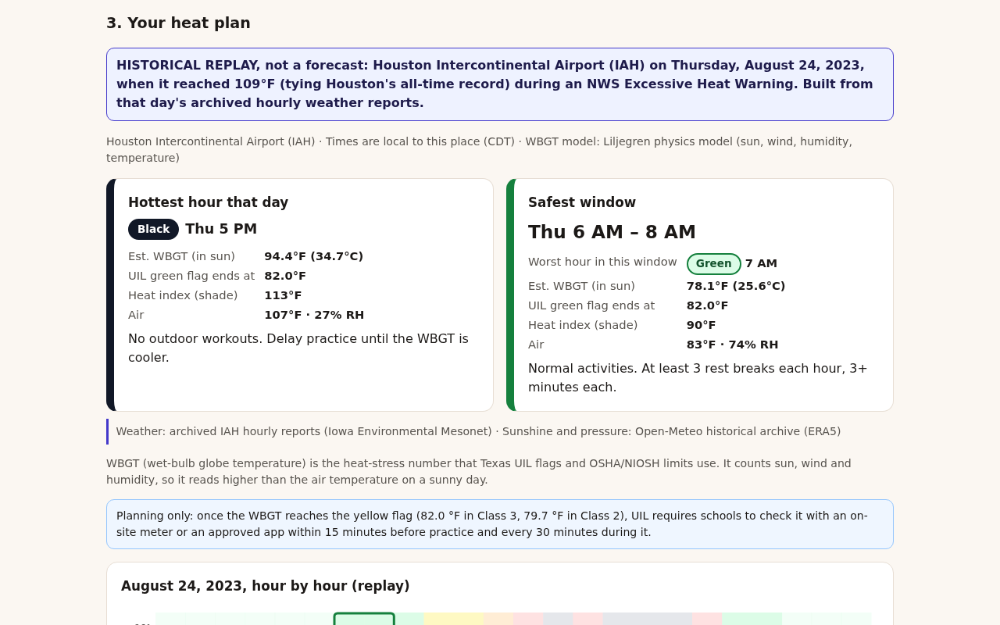

# HeatWise 🌡️

**Live:** https://aariv.me/Heatwise/ · **Record-day replay:** https://aariv.me/Heatwise/?replay=iah2023 · **Demo day (synthetic, labelled):** https://aariv.me/Heatwise/?sample=1

**Plan outdoor practice and work around the heat, hour by hour.**



*The finished plan from the one-click [record-day replay](https://aariv.me/Heatwise/?replay=iah2023) (a historical replay, not a forecast). Real screenshot of the app at 1280 px, taken with headless Chromium on Oct 11, 2026.*

## Features

HeatWise turns a free weather forecast into a personal heat-safety plan for student athletes, marching-band members, coaches, and outdoor workers. You tell it *where*, *what you're doing*, and *for how long*; it tells you:

- **This hour:** your heat level right now, either as a **Texas UIL WBGT flag** (athletics and marching band) or against the **OSHA/NIOSH heat-stress limit** for *your* workload, acclimatization and clothing
- **Safest window:** the best time in the next 48 hours to schedule your session (within the hours you allow), with a warning if even that window hits a flag that caps practice length
- **Hour-by-hour chart and table** of estimated WBGT in the sun vs. the flag lines or your limit, plus the familiar NWS heat index
- **Water plan** from NIOSH hydration guidance (plus UIL's water rules in athletics mode)
- **Acclimatization planner** (NIOSH day-by-day build-up for people new to the heat)
- **Warning signs and first aid** from OSHA and the NWS, in **English and Spanish**
- **Shareable link and printable plan**, so a coach can send the whole team the same plan
- **Works with no signal** after one online visit: a small service worker (`sw.js`) keeps the app's own files, and the last forecast for each place (saved in the browser, up to 3 hours old, always labelled with its age) still shows at a field or job site with no connection
- **One-page coach plan** for any day in the plan: the safest practice window, an hour-by-hour flag strip, the rules for each flag that day, water, a before-practice checklist and first aid. Print it (or save as PDF) in **English, Spanish, or both** (one page per language), or share it as plain text for a team chat
- **One-click replay of Houston's record day** ("▶ Replay Houston's record day (Aug 24, 2023)" at the top of the page): runs the archived IAH weather from the day Houston hit 109°F through the normal plan view, clearly labelled as a historical replay, so judges and coaches can see what HeatWise does on a dangerous day even when today's forecast is mild

Built for **EurekaDev 2026**, Coding Track, Problem in the Community.

## Judge it in 60 seconds

1. Open **https://aariv.me/Heatwise/?replay=iah2023**: Houston's record day (Aug 24, 2023, 109°F at IAH) runs through the normal plan view, labelled HISTORICAL REPLAY. For football it picks 6–8 AM (green) as the safest window, while noon–6 PM is red or black flag (black at 1 PM and 3–5 PM).
2. Type your own town in **Where** (any U.S. place uses the National Weather Service grid). Switch **EN / ES** at the top; everything, including the printed coach sheet, changes language.
3. Run the tests (Node 18+, no install):
   ```bash
   git clone https://github.com/draarivpatel-ui/Heatwise && cd Heatwise
   node tests/heat.test.mjs        # ends with: 76 tests passed.
   ```
   Optional browser checks (rate limits, offline, print) are listed under **Tests** below; GitHub Actions runs them on every push.

---

## Why

Heat is getting deadlier, and the people at risk are often the ones who don't get to pick their hours.

- U.S. heat-related deaths rose from 1,069 in 1999 to **2,325 in 2023**, the highest in the 25-year study period ([Howard et al., *JAMA*, 2024](https://jamanetwork.com/journals/jama/fullarticle/2822854)).
- Texas recorded **334 heat deaths in 2023** (preliminary state data, Jan 1–Nov 30), the most since the state started tracking in 1989, and **Harris County had the most of any Texas county** ([Texas Tribune, Jan 12, 2024](https://www.texastribune.org/2024/01/12/texas-heat-deaths-2023-record-climate-change)).
- OSHA notes outdoor workers have died of heat stroke on days when the maximum heat index was **only 86°F**, and that the weather-app heat index can underestimate real risk because it ignores workload, sun, and clothing ([OSHA](https://www.osha.gov/heat-exposure/hazards)).

Most weather apps answer "how hot is it?" HeatWise answers the question a coach or worker actually has: **"Is it safe for *us* to do *this*, and if not, when?"**

## How it works

1. **Forecast:** for **U.S. places**, hourly temperature, humidity and 10 m wind come from the **National Weather Service gridded forecast** ([api.weather.gov](https://www.weather.gov/documentation/services-web-api) `/points` → `forecastGridData`, the same NDFD grid behind the NWS heat index and WBGT forecasts). Solar radiation and surface pressure come from [Open-Meteo](https://open-meteo.com/), because the NWS grid has no sunshine value. **Outside the U.S., or if the NWS request fails or times out**, every input comes from Open-Meteo. Both are free with no API key. The plan says which source it used (and links to the NWS forecast for that spot); when it had to fall back inside the U.S., it says so and warns that the backup read WBGT low in testing. See [`js/forecast.js`](js/forecast.js).
2. **WBGT in the sun** (wet-bulb globe temperature, the index OSHA, NIOSH, the military, and Texas UIL use) is estimated with the **Liljegren et al. (2008)** physics model: it solves the heat balance of a black globe and a wet wick using the sun's angle (NOAA solar-position equations), sunshine, wind (scaled from 10 m to 2 m), humidity, and temperature, then `WBGT = 0.7·Tnwb + 0.2·Tg + 0.1·Ta`. The JavaScript port is tested against the open-source reference implementation (pywbgt) to within 0.05 °C. If sun or wind data are missing it falls back to the Australian Bureau of Meteorology approximation `WBGT ≈ 0.567·T + 0.393·e + 3.94` and marks hours where that estimate likely reads high.
3. **Texas UIL mode** (athletics and marching band): WBGT is compared with UIL's required WBGT activity flags (Class 3: green < 82.0 °F, yellow 82.0–86.9, orange 87.0–90.0, red 90.1–92.0, black ≥ 92.1; Class 2: 79.7 / 84.7 / 87.7 / 89.8 °F), and HeatWise shows UIL's rest-break, equipment and practice-length rules for each flag (orange: 2 h max, red: 1 h max, black: no outdoor workouts).
4. **Work mode:** effective WBGT = WBGT + clothing adjustment (OSHA/NIOSH: 0 °C for work clothes up to +11 °C for vapor-barrier coveralls), compared with the OSHA/NIOSH limit (unacclimatized / acclimatized):

   | Workload | Limit |
   |---|---|
   | Light | 28 / 30 °C |
   | Moderate | 25 / 28 °C |
   | Heavy | 23 / 26 °C |
   | Very heavy | 21 / 25 °C |

   HeatWise bands: < −2 °C *lower risk*, −2 to 0 *caution*, 0 to +2 *high*, > +2 *extreme*. (The limit is OSHA/NIOSH's; the ±2 °C bands are a HeatWise design choice.)
5. **Safest window:** among every run of consecutive allowed hours of your session length, choose the one whose *worst* hour is coolest (a minimax problem). It runs in **O(n)** using a monotonic-deque sliding-window maximum, and the test suite checks it against brute force on 500 random cases.
6. **Activity presets** (football practice, band rehearsal, mowing, a mail route…) pick the guideline and the closest OSHA workload category.
7. **Heat index** (shade, for familiarity only) uses the NWS Rothfusz regression with its published adjustments.

## Validation study: does HeatWise agree with the National Weather Service?

HeatWise's numbers come from code, so I checked them against the **National Weather Service's own forecast** for 8 Houston-area points (downtown Houston, Sugar Land, Katy, Pearland, Baytown, Tomball, Conroe, Galveston), over every forecast hour the NWS grid had: **1,472 point-hours**, Oct 10, 4 PM to Oct 18, 7 AM (Central), from the forecast issued Oct 10, 2026 at 4:06 PM CDT. It is framed as **agreement, not accuracy**: the NWS numbers are forecasts too. The same results, with charts, are in the app's **Validation** section, which recomputes every number in the browser from the archived data.

| Comparison | Hours | Bias (HeatWise − NWS) | Mean abs. difference | Other |
|---|---|---|---|---|
| **Heat index**, HeatWise formula on the NWS forecast temperature + humidity vs the NWS forecast heat index (hours ≥ 80 °F) | 770 | **+0.01 °F** | **0.28 °F** | 99.1% within 1 °F, 100% within 2 °F, max 1.04 °F; 89.1% identical after rounding to whole °F like the NWS; r = 0.998 |
| **WBGT, end to end, the app in the U.S.**: the archived NWS grid rebuilt in the API's format and run through the app's own input code (`nwsHourly()` + `mergeInputs()` in `js/forecast.js`: NWS temperature, humidity and wind, Open-Meteo sunshine and pressure), then HeatWise's Liljegren WBGT, vs the NWS WBGT forecast | 1,376 | **+0.56 °F** (day +1.54, night −0.42) | 1.07 °F (day 1.64, night 0.50) | Texas UIL flag (Class 3) matched in **90.6%** of hours, within one flag in 99.9%; in **118 of the 129** disagreements HeatWise showed the *more cautious* flag; r = 0.979. Identical to feeding the NWS weather straight from the snapshot, so the app's input code adds no error. |
| **WBGT, backup path** (all inputs from Open-Meteo: the app outside the U.S. or when the NWS fails, and the app's only path before this change) vs the NWS WBGT forecast | 1,376 | −3.92 °F | 4.33 °F | UIL flag matched in 86.2% of hours; in 163 of the 190 disagreements HeatWise's flag was *lower*. Over these hours Open-Meteo's forecast was on average 4.2 °F cooler and 8.7 RH points drier than the NWS forecast. |

**What this shows.** (1) The heat-index code reproduces the NWS's operational output; the remaining 0.28 °F is about what rounding the NWS's whole-degree values alone produces. (2) Given the same weather, HeatWise's physics-based WBGT agrees with the NWS's operational WBGT to about 1 °F, matches at night, and runs slightly warmer in the sun, which errs on the side of caution. (3) The biggest source of disagreement was not the formula but the **weather forecast feeding it**: this week Open-Meteo forecast cooler, drier air than the NWS, so the Open-Meteo-only pipeline read WBGT 3.9 °F low (the unsafe direction) and its flags were lower than the NWS's in about 1 hour in 8. **So U.S. plans now use the NWS grid as input**, which moves the end-to-end bias from −3.92 °F to **+0.56 °F** (slightly cautious) on the same archived data. Open-Meteo stays as the source for sunshine and as the fallback.

### Replay: Houston's record heat, Aug 24, 2023

On Aug 24, 2023, Bush Intercontinental Airport (IAH) reached **109 °F**, tying Houston's all-time record, during an NWS Excessive Heat Warning ([NWS Houston August 2023 climate summary](https://www.weather.gov/media/hgx/climate/summary/Aug_2023_Regional_Climate_Summary.pdf); [NWS Storm Data, Aug 2023](https://www.weather.gov/media/hgx/stormdata/aug23hgx.pdf)). Running IAH's archived hourly reports (Iowa Environmental Mesonet ASOS archive) plus archived sunshine (Open-Meteo ERA5) through HeatWise:

- Heat index peaked at **117 °F** (3:53 PM report: 109 °F, 27% RH). WBGT in the sun peaked at **94.4 °F** (4:53 PM report).
- The UIL Class 3 flag was **black (no outdoor workouts) for 4 hours** (the 12:53, 2:53, 3:53 and 4:53 PM reports) and red for 3 more.
- The planner's safest 2-hour window between 6 AM and 9 PM was **6–8 AM, green flag, WBGT ≤ 78.1 °F**.
- Cross-check: HeatWise's heat index matched the Iowa Environmental Mesonet's independently computed heat index for all 24 reports to within 0.01 °F.

### Method and limits
- NWS data: `https://api.weather.gov/points/{lat},{lon}` → `forecastGridData` (Houston/Galveston office, NDFD). Grid values cover 1–N hours each (ISO-8601 durations) and are expanded to hourly steps. Only hours valid at or after the issue time are used (the grid also carries a few already-past hours that are not refreshed with the rest). Missing values (null, and −120 °F) are dropped.
- Heat index is compared only at ≥ 80 °F, where it is defined (below that the NWS reports the air temperature).
- Replay: each routine METAR (at :53) stands for the following top of the hour; airports do not measure sunshine, so solar radiation and pressure come from the ERA5 reanalysis.
- Limits: one forecast issue in October (few very hot hours); agreement with a forecast is not the same as matching a WBGT meter on a field; the NWS WBGT uses its own method and inputs (sky cover rather than measured sunshine).
- Reproduce: `node scripts/fetch-validation-data.mjs` re-downloads everything into `data/validation/`; the tests (`node tests/heat.test.mjs`) re-run the comparisons on the archived snapshot.

## Tech

- Plain **HTML, CSS, and JavaScript (ES modules)**. No framework, no build step, no backend, no tracking.
- Works on phones, and you can print the plan or save it as a PDF.
- **NWS API** (api.weather.gov) for U.S. temperature, humidity and wind, and **Open-Meteo** Forecast and Geocoding APIs (free, no key). The two forecast requests run in parallel. NWS usage rules followed: the API asks for an identifying User-Agent; browsers don't let a page set that header, so the browser sends its own (the API accepts browser requests and returns `Access-Control-Allow-Origin: *`), while the Node data script sends a descriptive one. Only CORS-safelisted headers are sent (`Accept: application/geo+json`), so there is no preflight; coordinates are rounded to 4 decimals (more decimals get a redirect); a 429/5xx from the grid endpoint is retried once; a 9 s timeout and a stale-grid check (> 36 h old) fall back to Open-Meteo. Grid hours before the issue time are ignored (they aren't refreshed). If Open-Meteo fails but the NWS works, the plan uses NWS data with the simpler WBGT formula. If neither loads (offline, rate limits), HeatWise says so, shows a clearly labelled **synthetic sample day**, keeps your place in the link, and offers **Try again**.
- All math lives in pure functions in [`js/heat.js`](js/heat.js) with a dependency-free test suite in [`tests/heat.test.mjs`](tests/heat.test.mjs).
- **Keyboard and screen reader (Oct 11, 2026):** headless Chromium at 1280 and 390 px, English and Spanish, keyboard only: place search, the place picker (arrow keys, Esc), "Refresh now / Actualizar ahora" and the saved/stale forecast labels. Focus order, a visible focus ring at every stop, no keyboard trap, every status change (searching, picker, saved forecast, "service didn't answer", "Forecast updated", not found, search down) announced through the `aria-live` status line, and axe-core WCAG 2.0/2.1 A/AA + best practice: **0 violations** in all 7 states × 4 runs (156 checks, plus 28 in the Refresh-now check).
- **Lighthouse (mobile, run against the live site https://aariv.me/Heatwise/, Oct 11, 2026, 3 runs):** Performance 98–99, Accessibility 100, Best Practices 100, SEO 100; first paint 1.3–1.4 s, layout shift 0. No third-party CSS, fonts or scripts. The page ships its English text in the HTML (so nothing jumps when the scripts translate it), preloads its ES modules, and computes the validation study (~1,000 hours of WBGT) only when you scroll near it.

```
index.html        UI markup
styles.css        styles (incl. print stylesheet)
js/heat.js        heat math: Liljegren WBGT, heat index, UIL flags, OSHA/NIOSH limits, best window, hydration, acclimatization
js/i18n.js        English/Spanish strings + activity presets
js/forecast.js    forecast inputs: NWS grid (U.S.) + Open-Meteo sunshine, Open-Meteo fallback, source label data
js/places.js      place search: Open-Meteo geocoding with an 8 s timeout, state-hint + population ranking, when to skip the picker
js/app.js         rendering (SVG chart), sharing, record-day replay, coach plan sheet
js/plan.js        replay hours (IAH Aug 24, 2023) and the one-page coach plan (per-day window, flag strip, share text)
js/validation.js  validation study math: NWS grid parsing, agreement statistics, 2023 replay
js/validation-ui.js  the Validation section (loads data/validation/, draws the charts)
data/validation/  archived NWS + Open-Meteo forecast snapshot (Oct 10, 2026) and the IAH Aug 24, 2023 replay data
scripts/fetch-validation-data.mjs  re-downloads the validation data from the NWS, Open-Meteo and IEM
tests/heat.test.mjs  unit tests (node tests/heat.test.mjs)
tests/make_reference.py  regenerates the pywbgt/pvlib reference values in tests/fixtures/
sw.js             service worker: offline copy of the app's own files (network first)
tests/browser/           optional Chromium checks (429/offline, coach sheet, replay, full plan)
review-log.md     what each review pass found and fixed
```

## Run it

**Online:** https://aariv.me/Heatwise/ (GitHub Pages from `main` / root).

**Locally:**
```bash
git clone https://github.com/draarivpatel-ui/Heatwise.git
cd Heatwise
python3 -m http.server 8000     # ES modules need http://, not file://
# open http://localhost:8000  (try http://localhost:8000/?sample=1 for the demo day)
```

**Tests** (Node 18+):
```bash
node tests/heat.test.mjs
```
The tests check the Liljegren globe and wet-bulb temperatures and end-to-end WBGT against pywbgt reference values, the sun position against NREL SPA (pvlib), the heat index against NWS chart values, the BoM fallback against BoM's worked example (29.4 °C / 59% RH → ≈30 °C), the UIL flag edges for Class 2 and 3, OSHA/NIOSH limits and clothing factors, the best-window algorithm (including the brute-force comparison), hydration and acclimatization math, DST-aware local hours, that every English string has a Spanish one, and that the guidance text quotes the same numbers as the code. Eight more tests cover the validation study: NWS duration parsing and missing-value handling, the agreement statistics, the archived NWS snapshot (heat index MAE < 0.5 °F, UIL flag agreement > 85%), and the 2023 replay (109 °F, heat index equal to IEM's within 0.1 °F, safest window in the early morning). Twelve cover the forecast inputs: the NWS-area check, the grid parser on a real api.weather.gov response (multi-hour values, °F and m/s units, −120 °F missing values, RH from dewpoint, pre-issue hours), the merge (NWS temperature/humidity/wind, Open-Meteo sunshine/pressure), every fallback with a fake fetch (NWS 500, grid 503 retried once, outside the U.S. with no NWS request, `/points` 404, stale grid, timeout, Open-Meteo down → NWS-only, both down → error), that the app's U.S. path reproduces the NWS-weather validation result and errs warm, and that the source labels exist in both languages and quote the measured backup bias. Five cover the record-day replay and the coach plan: the replay through the plan view gives exactly the validation replay's WBGT and flags; the coach plan for Aug 24, 2023 picks 6–8 AM (green) and counts every black-flag hour; edge cases (no window fits, whole-day hours, a forecast spanning three local days across the end of daylight saving time); the share text in English and Spanish (every hour, the window, 911, the replay label, no English words left in the Spanish); and the page wiring (button above the form, print CSS that prints only the sheet with one page per language). Five cover place search (`js/places.js`): Houston-area towns such as Houston, Katy and Spring open straight away while truly ambiguous names (Pasadena TX vs CA) still ask, a ", TX" style state hint decides it, a stalled connection gives up after 8 seconds instead of hanging on "Searching…", and on a phone the plan's answer comes before the source notes, and same-looking choices (two "Springfield, Missouri, US") get their county or coordinates so the list never shows the same label twice. One checks the time-zone label: it comes from the place's IANA zone and shows both abbreviations ("CDT → CST") when the 48 hours cross a clock change. Seven cover the saved forecast and **Refresh now**: a repeat lookup within 30 minutes makes no new requests, a rate limit (HTTP 429) after that falls back to the saved answer for up to 3 hours, the app still works with no storage, a forced refresh skips the 30-minute reuse and re-saves, a forced refresh hit by a 429 keeps the saved answer and labels it honestly, the English/Spanish labels and the button wiring, and the keyboard/screen-reader behaviour (results announced in the status line, focus put back after a refresh, a visible focus ring on the status line). Two cover going offline: with no connection at all the saved forecast still stands in (labelled), with nothing saved it fails fast instead of hanging, and the app then says you're offline (in English or Spanish, re-worded when you switch) rather than "try again in a minute". One checks the offline service worker (`sw.js`): it caches every file the page loads plus the replay data, answers from the network first, never caches the weather APIs, and deletes only old HeatWise caches. One more re-computes every validation and replay number quoted on the submitted Devpost page (770 hours, 0.28 °F, r = 0.998, −3.92 → +0.56 °F, 90.6% of 1,376 hours, 118 of 129, 117 °F / 94.4 °F, 4 black + 3 red hours, 6–8 AM), so a later change can't quietly make the page wrong. One checks that every status line the app can show is re-worded when you switch language, and that the acclimatization box is kept to 10–720 minutes. One is a table of real Open-Meteo answers for state hints ("Bluefield, West Virginia" opens West Virginia, not a West Virginia/Virginia list; "Santa Fe, New Mexico" never matches the country Mexico). One is a table of shared-link values: `?lang=`, `?preset=`, `?wl=` and `?cl=` accept only the app's own keys, never built-in names such as `constructor` or `toString`. One checks that every outside link is https, and one that the link preview (Open Graph + large Twitter card) points at the live page and a real 1280×800 screenshot. 79 tests in total; all 79 pass (re-run Oct 11, 2026). One of them checks that the plan defines WBGT in plain words in both languages.

**Browser checks** (optional; Python 3 + Playwright + Chromium + poppler's `pdfinfo`/`pdftotext`; set `CHROME_PATH=/usr/bin/chromium` to use a system Chromium). Each serves the folder locally and stubs the weather APIs; the print checks render real Letter PDFs. GitHub Actions (`.github/workflows/tests.yml`) runs the unit tests and all eight on every push.
```bash
python3 tests/browser/offline_429_qa.py   # 16 checks: Open-Meteo rate limit (HTTP 429) and a device that goes offline, with and without a saved forecast, EN/ES;
                                          # with the service worker, a shared link reloads with no signal and the record-day replay still loads
python3 tests/browser/axe_states_qa.py    # 180 checks: axe-core 0 violations in 9 states (landing, UIL, sample, forecast plan, picker, not found, forecast down, location denied, replay) x 390/1280 px x EN/ES, again after switching language mid-flow, no sideways scroll
python3 tests/browser/lang_flash_qa.py    # 15 checks: a Spanish visitor (browser language or ?lang=es) never sees the English page flash before js/app.js runs; ?lang=en/fr still English; 3 s fail-safe if the script never arrives
python3 tests/browser/edge_inputs_qa.py   # 58 checks at 390 px, EN/ES: acclimatization 5000/5/0/blank/junk and session 0/99/2.5/-3/blank -> the box shows the value the plan used; same start/finish hour explained; 1-letter search; every status line re-worded on a language switch; typed values and the plan kept
python3 tests/browser/coach_print_qa.py   # 90 coach-sheet PDFs: football/roofing, also midnight-to-midnight (all 24 hours, plus a hot day with every flag level)
                                          # x EN/ES page x 3 days x sheet EN/ES/Both -> 1 Letter page per language
python3 tests/browser/place_picker_qa.py  # 13 checks at 390 px, EN/ES: a 58-letter place name and three same-looking Springfields -> distinct labels,
                                          # no sideways scroll with the picker open or on the long-named place's plan,
                                          # time-zone label, and no visible text (incl. the WBGT formula) under 12 px
python3 tests/browser/url_params_qa.py    # 93 checks at 390 px: 31 shared links, real and hostile (?lang=constructor, ?wl=toString, dur=99, e=24, pd=2026-13-45, lat=999)
                                          # -> no script error, no blank menu, unknown values fall back to the defaults, valid ones apply exactly
python3 tests/browser/print_plan_qa.py    # 54 checks: the Aug 24, 2023 replay coach sheet says "Historical replay ... not a forecast" (EN/ES) and stays 1 page per language;
                                          # the full "Print / save PDF" plan (48-hour table) prints the HISTORICAL REPLAY banner only for the replay,
                                          # and its table header repeats on each page instead of sticking over the rows
```
Last run Oct 11, 2026: 16/16 offline/429, 180/180 axe, 15/15 language-flash, 58/58 edge-input, 13/13 place-picker, 93/93 shared-link checks, 90/90 coach-sheet PDFs and 54/54 print checks pass.

## Limitations (being honest)

- WBGT here is **estimated from a forecast**, not measured. The Liljegren model is the standard physics approach, but the inputs are a forecast for a grid cell, not your field or roof: clouds, wind and humidity can differ, and artificial turf, asphalt, and bowl-shaped stadiums can be hotter. OSHA recommends an on-site WBGT meter, and UIL requires schools to check WBGT with a meter or an approved app before and during practice. HeatWise is for **planning ahead**, not for that check.
- When the forecast has no sun or wind data, the simple BoM fallback is used; it tends to read **high at night, in clouds, or in wind** (HeatWise marks those hours with *).
- The validation study found that Open-Meteo forecast about 4 °F cooler and drier air than the NWS during the test week, so an Open-Meteo-only WBGT read about 3.9 °F lower than the NWS WBGT forecast. U.S. plans now use the NWS grid (end-to-end bias +0.56 °F), but **places outside the U.S., and U.S. plans when the NWS doesn't answer, still use Open-Meteo alone**; the study can't say how far off it is outside Houston. The app labels those plans.
- The validation is one October week from one NWS forecast issue in one region; the NWS WBGT is itself a forecast, not a meter reading.
- Personal factors (medications, illness, fitness, prior heat illness) are not modeled.
- The Spanish text was written for this project and checked against the English, but it has **not yet been reviewed by a native speaker**.
- HeatWise is a **screening and planning tool, not medical advice**. When in doubt, cool the person and call 911.

## What's next

- Repeat the validation over a full summer, and against on-site WBGT meter readings
- Team mode: a coach dashboard with roster acclimatization tracking
- Alerts when the next practice window turns high-risk
- More languages (Vietnamese, Chinese, and Urdu are widely spoken in the Houston area), reviewed by native speakers
- A native-speaker review of the Spanish

## Data sources

- **Live forecast:** National Weather Service gridded forecast (api.weather.gov) for U.S. temperature, humidity and wind; Open-Meteo Forecast API for sunshine and pressure, and for everything outside the U.S. or when the NWS fails; Open-Meteo Geocoding for place search. Free, no API keys.
- **Validation snapshot** (`data/validation/`): the NWS and Open-Meteo forecasts for 8 Houston-area points archived on Oct 10, 2026.
- **Record-day replay:** IAH hourly reports from the Iowa Environmental Mesonet ASOS archive, plus Open-Meteo ERA5 sunshine and pressure.
- **Rules and thresholds:** Texas UIL heat plan, OSHA/NIOSH heat-stress limits, NWS heat-index equation (full list below).

## AI assistance

This project was built with help from an AI assistant (Hark), which drafted code, tests and copy under Aariv Patel's direction. The app calls no AI service at runtime: every number comes from the published formulas and thresholds listed below, and the tests check them against reference implementations and official values.

## Sources

- OSHA, *Heat Hazard Recognition* (NIOSH limits, clothing factors, workload table): https://www.osha.gov/heat-exposure/hazards
- OSHA, *Water. Rest. Shade.*: https://www.osha.gov/heat-exposure/water-rest-shade
- OSHA, *Heat-Related Illnesses and First Aid*: https://www.osha.gov/heat-exposure/illness-first-aid
- NWS, *Heat Cramps, Exhaustion, Stroke*: https://www.weather.gov/safety/heat-illness
- UIL, *2026-2027 Heat Stress & Athletic Participation REQUIRED Plan* (WBGT flags, monitoring, rapid cooling zones): https://www.uiltexas.org/health/info/heat-stress-and-athletic-participation
- Liljegren JC et al. (2008), *Modeling the Wet Bulb Globe Temperature Using Standard Meteorological Measurements*, J Occup Environ Hyg 5(10):645–655: https://doi.org/10.1080/15459620802310770
- CDC/NIOSH, *Workplace Recommendations* (hydration, acclimatization): https://www.cdc.gov/niosh/heat-stress/recommendations/index.html
- Australian Bureau of Meteorology, *Thermal Comfort observations* (fallback WBGT approximation): https://www.bom.gov.au/info/thermal_stress/
- NOAA/NWS WPC, *The Heat Index Equation*: https://www.wpc.ncep.noaa.gov/html/heatindex_equation.shtml
- Howard JT et al. *Trends of Heat-Related Deaths in the US, 1999–2023.* JAMA. 2024;332(14):1203–1204: https://jamanetwork.com/journals/jama/fullarticle/2822854
- Texas Tribune, Jan 12, 2024: https://www.texastribune.org/2024/01/12/texas-heat-deaths-2023-record-climate-change
- National Weather Service API (gridpoint forecasts, used for validation): https://www.weather.gov/documentation/services-web-api
- NWS Houston/Galveston, *August 2023 Regional Climate Summary*: https://www.weather.gov/media/hgx/climate/summary/Aug_2023_Regional_Climate_Summary.pdf
- NWS Houston/Galveston, *Storm Data and Unusual Weather Phenomena, August 2023*: https://www.weather.gov/media/hgx/stormdata/aug23hgx.pdf
- Houston Public Media, Aug 25, 2023, *Houston ties record for hottest temperature ever recorded*: https://www.houstonpublicmedia.org/articles/news/weather/2023/08/25/460628/houston-ties-record-for-hottest-temperature-ever-recorded-in-city-at-109-degrees
- Space City Weather, Aug 25, 2023 (first official rain in almost 50 days): https://spacecityweather.com/thursday-matched-houstons-hottest-day-on-record-and-brought-our-first-official-rain-in-almost-50-days/
- Iowa Environmental Mesonet, ASOS/METAR archive (IAH hourly reports): https://mesonet.agron.iastate.edu/request/download.phtml
- Open-Meteo Historical Weather API (ERA5): https://open-meteo.com/en/docs/historical-weather-api
- Weather data by [Open-Meteo.com](https://open-meteo.com/) (CC BY 4.0)

## License

MIT © 2026 Aariv Patel
